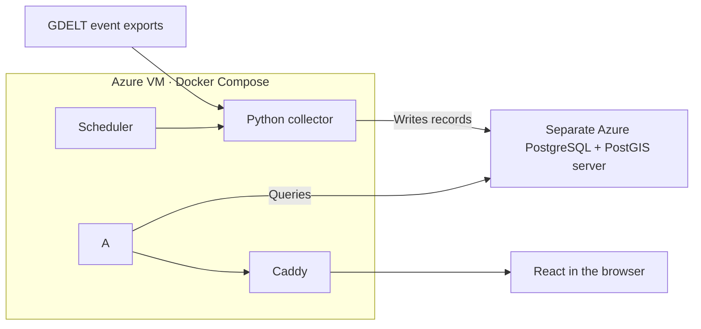

# Global News Monitor

Global News Monitor helps you see where events are being reported around the world, how reporting changes over time, and which articles you can follow to learn more. I built it as an independent project while studying CMDA at Virginia Tech. It was my first time building and deploying a live dashboard.

**[Open the live dashboard](https://global-news-monitor.northcentralus.cloudapp.azure.com/)** · **[Read the development story](docs/DEVELOPMENT_JOURNEY.md)**

The public site runs v1.2. The deployment and verification results are recorded on the development branch. [v1.2 production validation](docs/V1.2_PRODUCTION_VALIDATION.md) · [v1.1 GitHub release](https://github.com/fegalvan/Global-News-Monitor/releases/tag/v1.1.0)

## What you can explore

- Use the **map** or country selector to see where event records are concentrated. A country profile shows its most reported locations and opens a country-specific view of the coverage.
- Use **Trends** to compare equal periods. An available comparison shows how each category contributed to the difference and lets you open coverage for the period you want to inspect.
- Open **News coverage** to explore original GDELT links by country, category, and time. Switch between varied sources and most recent links, and open each record’s coded details. **Event records** shows the underlying entries individually.

The GDELT Project identifies events in news coverage using automated coding. Its records reflect which sources it collects and how those sources report. The same article can produce several records, and differences in record counts say more about reporting patterns than the severity of what happened. [GDELT Events codebook](https://data.gdeltproject.org/documentation/GDELT-Event_Codebook-V2.0.pdf)

## How it works

On the Azure Linux VM, the scheduler runs the Python collector to process GDELT’s 15-minute exports. The collector writes to PostgreSQL with PostGIS on a separate managed Azure server. FastAPI queries that database when the dashboard requests data. Caddy serves the frontend files and forwards API requests over the same HTTPS address. React runs in the visitor’s browser.

*Simplified deployment view. The collector and API share the database, while the browser talks to Caddy. PostgreSQL retains 17 days of event detail and 90 days of hourly history in production.*

## Project notes

| If you want to see… | Start here |
| --- | --- |
| How the project grew from a Python script to a live dashboard | [Development journey](docs/DEVELOPMENT_JOURNEY.md) |
| How the data, map, and comparisons work | [Technical walkthrough](docs/TECHNICAL_WALKTHROUGH.md) |
| How to run and test the project yourself | [Local setup](docs/LOCAL_DEVELOPMENT.md) |
| Request parameters and response shapes | [API reference](docs/API_REFERENCE.md) |
| Azure setup, roles, monitoring, backups, and recovery | [Deployment guide](docs/DEPLOYMENT.md) |
| What was verified at each release | [v1.1 validation](docs/V1.1_VALIDATION.md) · [v1.2 local validation](docs/V1.2_VALIDATION.md) · [v1.2 quality follow-up](docs/V1.2_QUALITY_VALIDATION.md) · [v1.2 production validation](docs/V1.2_PRODUCTION_VALIDATION.md) |
