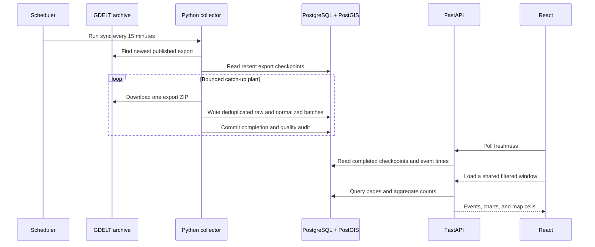
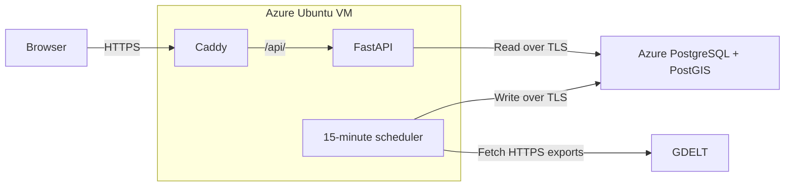
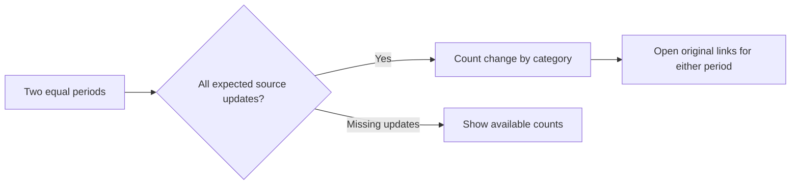

# Global News Monitor technical walkthrough

## From an export to a dashboard row

The application collects GDELT 2.0 Event exports. A record encodes an actor, an
action, and often a second actor and a location extracted from media coverage.
The original source link is a reference to that coverage. One report can yield
many records, and a dashboard count measures coded GDELT records.

## Ingestion and checkpointing

- [`src/connectors/gdelt/export_client.py`](../src/connectors/gdelt/export_client.py)
  reads the latest export pointer, chooses the Events ZIP, normalizes the
  legacy GDELT host to HTTPS on Google Cloud Storage, and retries transient
  connection errors, HTTP 429, and selected 5xx responses with exponential
  delay. It streams the ZIP to a spooled temporary file.
- [`src/connectors/gdelt/export_parser.py`](../src/connectors/gdelt/export_parser.py)
  extracts the export's UTC timestamp from its filename. It reads the
  tab-delimited Events file one row at a time and keeps the source fields
  needed by the application. Invalid short rows go to the parser error
  callback.
- [`normalize_event_for_insert`](../src/ingestion/transform.py) converts
  dates, numeric values, country codes, and identifiers to usable types. The
  dashboard's record time prefers `DATEADDED`, then uses `SQLDATE` at UTC
  midnight, then the export time. The separately stored occurrence date has
  day-level precision. The raw JSONB payload preserves the extracted fields,
  including the source URL and original CAMEO code.
- [`validate_and_clean_event`](../src/ingestion/validation.py) normalizes actor
  names, clears malformed codes and invalid coordinate pairs, bounds average
  media tone, and records quality flags. Obvious future outliers are dropped.
  The pipeline records parser and validation drops in `dropped_events`.
- [`ingest_export`](../src/pipeline/ingest_service.py) claims one timestamped
  checkpoint and processes rows in configurable batches. It commits each
  batch so an interruption can leave committed records. It commits the
  quality snapshot, checkpoint completion, and successful run status together
  after the file finishes. This distinction matters when interpreting
  freshness or a chart during recovery.

`build_dedupe_key` prefers GDELT's global event ID. If absent, it hashes a
normalized combination of report date, actors, action, location, and tone.
A unique PostgreSQL index on `(source, dedupe_key)` and
`INSERT ... ON CONFLICT DO NOTHING` enforce deduplication in the database.
[`insert_raw_and_normalized_batch`](../src/ingestion/repository.py) uses raw IDs
returned by the insert to create normalized records in the same transaction.
Retrying an interrupted export skips rows that were already committed. The
deterministic hash is an identity fallback and cannot tell whether differently
coded reports describe the same real-world event.

If the collector stops after committing its first batch, the raw and normalized
rows from that batch are already saved. The checkpoint for the file stays
unfinished. On retry, the unique index skips the saved rows. Completing the
checkpoint tells the dashboard the whole export has been processed.

## Classification

[`categorize_event`](../src/domain/events/categorization.py) applies cyber
rules, then crisis rules, then a mapping from the two-digit CAMEO root to the
dashboard's primary categories. Cyber and crisis overrides look for specific
terms in actor names, the location label, and the last three URL path segments.
The rules use word boundaries and keep publisher names and URL query parameters
out of this inference. Generic intelligence sharing and appeals follow their
CAMEO root unless the available context supports an override. Root `15`, which
describes military or police posture, now contributes to Conflict & military.
The dashboard uses Statements & diplomacy for the broad group of statements,
appeals, consultation, and related actions. An unmatched code falls back to
politics with a low rule score and a recorded reason. `category_confidence`
is assigned by the rule and has no empirical probability calibration. The
rules infer only from recorded metadata. [Quality follow-up](V1.2_QUALITY_VALIDATION.md)

[`get_event_label`](../src/main.py) uses the pinned dictionary for the exact
CAMEO code and shortens a few descriptions for display. Unrecognized codes
show as unknown. The event feed exposes both the label and the original code.

## Persistence and important queries

| Table | Purpose and relationships |
| --- | --- |
| `ingestion_runs` | One row per attempted export, with status, counts, and completion time. |
| `gdelt_export_checkpoints` | One row per source and export timestamp, with attempts, failure state, and coverage. |
| `raw_events` | Preserved parsed fields and flags. Each row belongs to an ingestion run. |
| `normalized_events` | One query-oriented row per raw event. Its generated `location_point` is PostGIS geography in SRID 4326. |
| `dropped_events` | Parser and validation rejects linked to the run. |
| `data_quality_audit` | Per-export quality counts and percentages recorded at completion. |
| `analytics_spike_snapshot` | A migrated schema artifact. The current spike route computes results from stored events at request time. |

The migration chain in [`migrations/versions`](../migrations/versions) creates
these tables and indexes. Revision 0005 widens the Alembic version column
before recording its 38-character revision ID. The PostgreSQL integration
fixture applies the actual chain to a dedicated database.

- [`fetch_events`](../src/ingestion/dashboard_queries.py) narrows rows using
  an inclusive event start and exclusive end. It orders by timestamp and ID
  descending and uses the pair as a cursor. The query fetches one extra row
  to decide whether another page exists. The join to raw detail happens
  after choosing the page. Equal timestamps are common in a 15-minute batch,
  which makes the ID tiebreaker necessary.
- [`fetch_analytics`](../src/ingestion/dashboard_queries.py) combines hourly
  totals and raw counts for partial edge hours into summary metrics, UTC
  buckets, countries, and categories. It also joins the expected 15-minute slot
  calendar to export checkpoints to report coverage by bucket. Coverage is
  independent of country and category and uses export time. The same source
  slot can contain records with different normalized timestamps.
- [`fetch_freshness`](../src/ingestion/dashboard_queries.py) reads the newest
  completed source checkpoint, latest completed ingestion run, latest
  normalized record time, and latest reported date. A backfill can advance
  run completion while leaving the newest source timestamp unchanged.
- The time, country/time, category/time, and category/country/time indexes
  support the filter paths. The normalized-to-raw unique index supports
  joins and ordered cleanup by raw ID. The GiST index supports potential
  geographic predicates. The existing grid query uses numeric arithmetic on
  latitude and longitude after filtering. See [index SQL](../sql/stage3_indexes.sql).

## Legacy statistical API

[`SPIKES_SQL`](../src/ingestion/repository.py) groups recent events by
country name and category, keeping groups with at least 10 recent records and
a historical baseline. The baseline uses observed UTC daily counts from the
15 days preceding the selected end, excluding the selected recent window.
Days with no recorded events for the group are excluded. The z-score is
$(r - \bar{x}) / \sigma$, where $r$ is the recent count and $\sigma$ is the
population standard deviation of those daily counts. It is null for a flat
baseline. Lift is $r / \bar{x}$. A roughly 24-hour selection is easiest to
interpret because the recent and baseline units then match. Partial days,
missing exports, and changes in media coverage can shift both measures. The
z-score is descriptive and has no calibrated significance threshold.

[`TENSION_SQL`](../src/ingestion/repository.py) groups actors and category for
records with Goldstein score at or below −5, retaining groups with at least
three records. It displays count, average, and minimum. The historical API
field names `avg_tone` and `worst_tone` refer to Goldstein scale here.
Goldstein scores describe CAMEO action types. They differ from the GDELT
average media tone field stored on the raw record.

The `momentum` CLI command is a diagnostic for observed rates. It divides
the last three hours of records by three and the last 24 hours by 24. The
v1.2 correction fixes the earlier denominator of eight. The windows overlap
and the CLI includes partial observations, so trends on the dashboard use
the coverage-gated matched periods below.

## Frontend

[`App.tsx`](../frontend/src/App.tsx) owns the country, category, and time
controls. It resolves one UTC window for every panel. The server enforces
a 30-day maximum. Country, category, and time filters are reflected in the
address bar so a reload or shared link restores the same selection.
[`useDashboard.ts`](../frontend/src/useDashboard.ts) requests
analytics and the first page together, aborts obsolete
requests, and resets the event cursor when selections change. On a failed
refresh it retains the last successful result for the same selection and
shows an error message. History, map, profile, and news coverage have
independent loading and error states. The coverage request starts when
someone scrolls to it or follows its dashboard link.

[`ActivityMap.tsx`](../frontend/src/ActivityMap.tsx) renders bundled Natural
Earth boundaries in Leaflet and draws occupied cells on one canvas. The
canvas sits above the geography and leaves pointer clicks available to
the country boundaries. A coordinate-based lookup supplies the cell tooltip.
Five fixed count bands use progressively brighter colors so the same count
looks consistent across time windows and viewport sizes. Country
clicks resolve to a GDELT code only where the boundary name can be matched.
[`mapGeometry.ts`](../frontend/src/mapGeometry.ts) unwraps polygons at the
antimeridian to avoid lines across the entire map. The chart component uses
Recharts. It plots only full UTC buckets with all expected source slots
completed, even if a partial bucket contains events. This prevents a final
15-minute slice from reading like a drop in the hourly activity rate.
Fully covered buckets with no matching reports show zero.

The browser checks freshness once a minute while visible. A new processed
source export moves the rolling window as a unit. The file's timestamp
identifies its batch slot and the checkpoint records the wall-clock ingestion
completion. GDELT can publish a batch before its filename timestamp.
An ahead-of-clock source slot extends the exclusive end just enough to include
that batch without labeling the containing chart bucket complete.
Custom ranges stay fixed. An event link is rendered only for an HTTP(S)
source URL.

## Scheduling, recovery, and deployment

[`sync_recent_exports`](../src/pipeline/scheduled_ingest.py) anchors a bounded
search to the latest published file. It searches 24 hours by default and
attempts up to eight exports per invocation. Completed or expired checkpoints
are skipped, failed attempts cool down for 15 minutes to four hours, and
in-range processing attempts can be reclaimed after the 30-minute stale
threshold. If the plan overflows, one slot is reserved for the newest eligible
export. The selected batch runs in timestamp order. A missing object or
unreadable archive is recorded and deferred while the plan moves on. A
systemic network or database failure exits so the next scheduled run can retry.

A session-level advisory lock covers the full plan and retention. Manual
imports use the same lock. The scheduled runner reuses the session, so the
existing per-export lock can be acquired and released without giving up the
outer lock. The local and VM scheduler limits a child invocation to 12 minutes.
The Render cron applies the same bound. A termination closes the database
session and releases its advisory lock. The checkpoint persists for recovery.

The production templates retain about 17 days of raw, normalized, and rejected
event detail. The job prunes bounded batches and marks older completed
checkpoints expired. PostgreSQL autovacuum can reuse space from deleted rows.
Checkpoints, run records, and quality summaries remain as smaller operational
records. See the [deployment guide](DEPLOYMENT.md) for cost, sizing, and rollout.

In Azure production, Docker Compose on one North Central US VM runs Caddy,
FastAPI, and [`run_scheduler.py`](../scripts/run_scheduler.py). Caddy
terminates HTTPS, serves the Vite build, and forwards `/api/` to FastAPI
over the Compose network. The browser uses one origin for both. The
only public web ports are Caddy's 80 and 443. SSH accepts keys from an
operator IP, and FastAPI has no host port.

PostgreSQL lives on an Azure Flexible Server with PostGIS. Keeping the
database separate leaves the 1 GiB VM's memory available for serving
requests and processing exports. It also separates database backups and
updates from app deploys. The database firewall accepts the VM's exact
static IPv4, and the connections verify the PostgreSQL server certificate
and hostname. [`compose.azure.yaml`](../deploy/compose.azure.yaml) uses
separate credentials for FastAPI and ingestion. The
[`azure-roles.sql`](../deploy/azure-roles.sql) grants SELECT to the API
on four tables and permits only the worker's required writes. A separate
owner applies Alembic migrations and has no credential in either running
container.

The scheduler starts with the VM's Docker services and polls every 15
minutes. This is separate from the browser's freshness polling. A closed
tab, a local computer shutdown, or an API restart does not stop collection.
The VM's memory was enough to run the services during launch, but the
Caddy build spent much of its time swapping during Go linking. Compiling
the patched binary off-host and scanning the packaged Linux image kept
build-time memory pressure away from the running app.
The [deployment guide](DEPLOYMENT.md#azure-production-deployment) covers
the resource sizing, billing meters, and production checks.

## Where to start when debugging

1. Check `/api/health` for API liveness and `/api/health/ready` for recent
   successful ingestion. A live service can still have an empty or stale feed.
2. Compare `/api/freshness` and the chart's checkpoint coverage. A recent run
   can coexist with an old source export or gaps in the selected history.
3. Run `python -m src.main runs` or inspect cron output. Look for a failed
   export, a skipped advisory lock, or an upstream outage.
4. Use `EXPLAIN (ANALYZE, BUFFERS)` on a representative filtered query. The
   time range, category selectivity, and index statistics all affect the plan.
5. Follow one event from its raw snapshot through `raw_event_id` and check
   its original CAMEO code, rule reason, and validation flags when a row
   looks surprising.

## v1.1 data and query architecture

### Separate source identifiers from normalized fields

GDELT's event action geography uses the FIPS country lookup. The two actor
affiliation fields use CAMEO's actor-country dictionary. For example, FIPS
`GB` is Gabon, FIPS `UK` is the United Kingdom, and CAMEO `GBR`
is an actor affiliation. Separating namespaces also fixes `ZA` (Zambia) and
`SF` (South Africa). The original event, geography, and actor fields remain
in `raw_payload`. An absent or placeholder country yields
`missing_country_code`, an unrecognized code yields `unmapped_country_code`,
and a known FIPS code yields a stored country. Coordinates are independently
checked. GDELT geography type 0 has no location, so its coordinate placeholders
are cleared. Type 1 identifies country-level precision, 2 and 5 are
administrative areas, and 3 and 4 are localities. These are source precision
classes. [GDELT event codebook](https://data.gdeltproject.org/documentation/GDELT-Event_Codebook-V2.0.pdf) · [FIPS lookup](https://gdeltproject.org/data/lookups/FIPS.country.txt) · [Actor lookup](https://gdeltproject.org/data/lookups/CAMEO.country.txt)

CAMEO codes stay strings. Validation checks membership in the pinned
taxonomy, so `010` and `0211` keep their leading zeros. GDELT's event label
file appends `106` to the `1056` description. The reference loader repairs
that line using the CAMEO manual. Input validation also rejects nonfinite
numerics, out-of-range Goldstein values, oversized event IDs, and timestamps
whose digit counts differ from the source format. Labels can help explain
records. GNM's broad categories are still heuristic and the original CAMEO
classification and source link provide important context. [Event-code lookup](https://gdeltproject.org/data/lookups/CAMEO.eventcodes.txt) · [CAMEO verb codebook](https://eventdata.parusanalytics.com/cameo.dir/Cameo.0.10b2.pdf)

### Use the least expensive representation that answers the question

A single aggregation of grouped counts supplies the summary, country totals,
category totals, and UTC time series. Complete hours use
`event_hourly_counts`. At most two partial hours read raw detail through the
existing event-time or country-time indexes. A filter contained in a single
hour reads detail once. The analytics and history endpoints each use a read-only
repeatable-read transaction to keep their own queries consistent. Coverage runs
as a separate query over retained event detail. The country selector uses a small reference response,
independent of map and analytics queries.

For a full day of country totals, the database can add stored counts for
24 hours because ingestion already grouped the individual records. The
event table and original links still go back to the retained detail.

Statement-level normalized-row triggers apply grouped deltas in the same
transaction as each batch. Inserts update both live and historical totals.
Actual edits update both, and retention deletes subtract from live counts
while preserving archival counts. The existing raw dedupe constraint prevents
duplicate trigger increments. Checkpoint completion records historical
coverage separately so a known zero survives raw expiry. Before the upgrade,
already-expired checkpoints cannot establish historical coverage.

Historical counts are kept for 90 days, and the normal 17-day raw retention is
unchanged. A deliberately configured raw window longer than 90 days may keep
the corresponding live aggregate row until raw removal. Old checkpoint
metadata stays available to prevent reprocessing an expired export. The map
uses the retained latitude and longitude pair and chooses a grid small enough for
the requested extent while keeping the maximum cell count bounded. With
`west > east` the viewport crosses the antimeridian. Countries can be chosen
directly from available map boundaries or from the FIPS catalogue. The
viewport map scans matching raw rows, using a partial time index that includes
latitude and longitude where both coordinates exist. The world grid has
90 × 180 possible two-degree cells. Smaller extents use finer grids at
one, one half, or one quarter degree within a bounded response size.
Each occupied cell contributes to the viewport total. The compatibility response from
`/analytics` still offers its original two-degree grid when requested. PostGIS supplies the
stored geography points and spatial index. The grid queries use numeric bounds
and group coordinates with ordinary latitude and longitude arithmetic.

### Compare equal periods and gate the score on coverage

The two comparisons use successive non-overlapping 24-hour or seven-day
periods ending at the latest whole UTC hour at or before the selected end.
The archive is indexed by the dashboard's event record timestamp.
Checkpoint coverage comes from the 15-minute export clock. A fully observed
window can contain zero matching events. A window with an absent or failed
export has partial coverage. Its observed count remains visible, while the
change is unavailable. The absolute difference is current minus previous.
Percentage change divides that difference by the previous count. Starting in
v1.2 it requires at least 20 records in the previous period. The absolute change
still appears for fully observed periods below that threshold. Each plotted daily value needs 96 complete exports
and a trailing mean requires seven consecutive complete UTC days.

For example, an increase from two to four records across two complete days
shows a change of +2 without a percentage. If either day is missing an export,
the observed counts remain visible and the +2 is withheld as well.

For the latest complete 24-hour window, sample the previous 12 weekly
windows ending at the same UTC weekday and hour. Require eight fully covered
periods and a median of at least 20. Weekly matches control for day-of-week
and time-of-day reporting patterns. The median resists isolated extreme
days. The median absolute deviation is the median distance from that
median. The scale is the larger of `1.4826 × MAD` and the square root of
the median. The factor is the inverse of the standard normal's 75th
percentile, which makes scaled MAD consistent for standard deviation under
a normal model. The count-scale
floor prevents a zero or tiny MAD from yielding an unstable score.

As an illustration, take five historical counts of 38, 39, 40, 41, and 42.
The median is 40 and the median distance from it is 1. Replacing 42 with 142
leaves both values unchanged, while the mean rises from 40 to 60 and the
standard deviation grows. This example illustrates the calculation. The
dashboard requires at least eight comparable windows to score a change.

The score is the observed excess divided by that scale. A flag requires a
score of at least 3.5, an excess of at least 20 reports, and a relative
increase of at least 50%. The thresholds are transparent screening rules.
They require operational calibration once genuine comparable history has
accumulated. Expected activity is the baseline median, and the scale is a
description of variability. The published score has no calibrated false-alarm
probability or confidence interval. Media volume can be overdispersed,
serially correlated, and sensitive to the mix of sources. [NIST guidance on modified Z-scores](https://itl.nist.gov/div898/handbook/eda/section3/eda35h.htm)

The dashboard checks one selected country/category combination at a time.
It avoids sparse cross-country rankings and leaves the older spike and
Goldstein summaries available through their existing API routes. The older
spike calculation compared unequal durations and omitted zero-activity days.
The Goldstein score describes an event code's expert-assigned conflict or
cooperation weight. It supports descriptive actor-pair summaries with those
limits in mind.

## Finding the news coverage behind a change

The Events export includes `SOURCEURL`, the first news reference GDELT
associated with each event, and `DATEADDED`, when GDELT added the event to
its database. GNM has the event label, category, actors, and event location
from the same record. The export does not provide the article title or its
publication timestamp. The link list uses the source hostname, event label,
and dashboard record time with the ingestion fallbacks described above.
The GDELT Mentions dataset could connect additional reporting to event IDs,
but would require its own ingest, storage, and retention. GNM uses the
Events fields it already collects and leaves the article on the publisher's
site. [GDELT 2.0 Events and Mentions codebook](https://data.gdeltproject.org/documentation/GDELT-Event_Codebook-V2.0.pdf)

The coverage query takes the latest 20,000 matching retained records in
timestamp and ID order, then looks up each raw payload by its primary key.
That keeps URL lookup work bounded as the retained raw table grows. The query
keeps ordinary HTTP(S) URLs with a public-style hostname, omitting credentials,
nonstandard explicit ports, and malformed references. Identical stored URLs
after trimming share a row. The query preserves different parameters,
fragments, paths, and schemes because they can identify different resources.
This leaves some duplicate stories across URL variants and syndicated copies.
Leading sources are lowercased hostnames ranked by distinct URLs in this
slice. The dashboard labels the cap when the slice is truncated. Most recent
uses time and event ID. Varied sources draws from the newest 72 candidate URLs,
brings two links per host into each round, and orders by hour and record detail
within the round. The detail check uses the presence of a valid action code,
two distinct actor names, and known location precision. Exact localization and
many similar records offer little evidence about whether an article supports
the coded event, so neither receives a special boost. A source filter uses
recent order. Both views show the latest matching record for each link and use
the same input counts. The API event list still exposes individual records.

When both matched periods have full source coverage and consistent category
rules, v1.2 subtracts previous counts from current counts for each category.
These changes sum to the overall
change. Selecting a category change uses the category and exact UTC bounds of
the period with more records. The same filters apply to the map, coverage,
and event list, and the links offer examples to inspect. They cannot identify
what caused the difference. The link sample comes from the raw 17-day window,
so a historical comparison can still be available after the sources have aged
out of the database. The Goldstein actor-pair summary stays in the legacy API
and CLI because weights assigned to event types give limited evidence about
geopolitical tension. GDELT also offers a four-way cooperation and conflict
classification called `QuadClass`. GNM's parser does not retain that field.
Adding a comparable historical series would require extending ingestion and
establishing coverage for the new classification.

*Simplified comparison flow. URLs come from retained event detail, while counts come from hourly history.*

### Recategorizing retained history

Revision `0012_category_quality` applies the same v1.2 rules to retained rows
that new ingestion uses. Updates pass through the existing rollup triggers,
which move the affected counts between categories in the same transaction. The
migration keeps earlier category values for changed rows until their detail
expires. It records the latest archive hour with counts beyond the available
detail. Category comparisons and the weekly category baseline use only hours
after that point. Earlier category counts are retained with their original
definitions, and totals across all categories remain usable.

The parser preserves `ActionGeo_Type` and both CAMEO actor-country fields for
new exports. The backfill script stores old fields in a small table beside the
original payload. It requires the completed export slot, unambiguous global
event ID, and matching original date, action code, country code, and URL. A
missing archive or different row leaves that context unknown. The original
payload stays intact. If verified type `0` conflicts with stored map coordinates,
the normalized coordinates and geolocated count are corrected together.
[Backfill and rollback rehearsal](V1.2_QUALITY_VALIDATION.md#migration-recovery-and-archive-limits)
