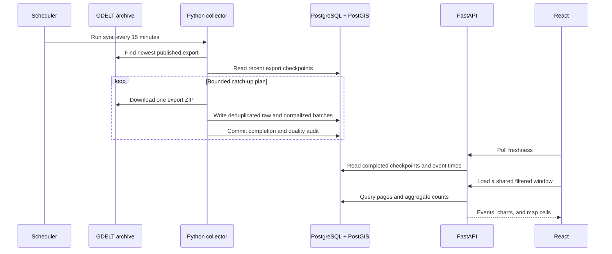

# Global News Monitor technical walkthrough

## From an export to a dashboard row

The application collects GDELT 2.0 Event exports. A record encodes an actor, an
action, and often a second actor and a location extracted from media coverage.
The original source link is a reference to that coverage. One report can yield
many records, and a dashboard count measures coded GDELT records.

## Ingestion and checkpointing

- [`src/connectors/gdelt/export_client.py`](../src/connectors/gdelt/export_client.py)
  reads the latest export pointer, chooses the Events ZIP, normalizes the
  legacy GDELT host to HTTPS on Google Cloud Storage, and retries transient
  connection errors, HTTP 429, and selected 5xx responses with exponential
  delay. It streams the ZIP to a spooled temporary file.
- [`src/connectors/gdelt/export_parser.py`](../src/connectors/gdelt/export_parser.py)
  extracts the export's UTC timestamp from its filename. It reads the
  tab-delimited Events file one row at a time and keeps the source fields
  needed by the application. Invalid short rows go to the parser error
  callback.
- [`normalize_event_for_insert`](../src/ingestion/transform.py) converts
  dates, numeric values, country codes, and identifiers to usable types. The
  dashboard's record time prefers `DATEADDED`, then uses `SQLDATE` at UTC
  midnight, then the export time. The separately stored occurrence date has
  day-level precision. The raw JSONB payload preserves the extracted fields,
  including the source URL and original CAMEO code.
- [`validate_and_clean_event`](../src/ingestion/validation.py) normalizes actor
  names, clears malformed codes and invalid coordinate pairs, bounds average
  media tone, and records quality flags. Obvious future outliers are dropped.
  The pipeline records parser and validation drops in `dropped_events`.
- [`ingest_export`](../src/pipeline/ingest_service.py) claims one timestamped
  checkpoint and processes rows in configurable batches. It commits each
  batch so an interruption can leave committed records. It commits the
  quality snapshot, checkpoint completion, and successful run status together
  after the file finishes. This distinction matters when interpreting
  freshness or a chart during recovery.

`build_dedupe_key` prefers GDELT's global event ID. If absent, it hashes a
normalized combination of report date, actors, action, location, and tone.
A unique PostgreSQL index on `(source, dedupe_key)` and
`INSERT ... ON CONFLICT DO NOTHING` enforce deduplication in the database.
[`insert_raw_and_normalized_batch`](../src/ingestion/repository.py) uses raw IDs
returned by the insert to create normalized records in the same transaction.
Retrying an interrupted export skips rows that were already committed. The
deterministic hash is an identity fallback and cannot tell whether differently
coded reports describe the same real-world event.

## Classification

[`categorize_event`](../src/domain/events/categorization.py) applies cyber
rules, then crisis rules, then a mapping from the two-digit CAMEO root to the
dashboard's primary categories. Cyber and crisis rules inspect the event code
and keywords in actor names, the location label, and the source URL. They do
not analyze article text. An unmatched code falls back to politics with a
low rule score and a recorded reason. The stored `category_confidence` is
assigned by the rule and has no empirical probability calibration.

[`get_event_label`](../src/main.py) separately renders a readable CAMEO label.
It checks the exact code first, falls back to the root label, and reports an
unknown event if neither lookup succeeds. The event feed exposes both the
label and original code.

## Persistence and important queries

| Table | Purpose and relationships |
| --- | --- |
| `ingestion_runs` | One row per attempted export, with status, counts, and completion time. |
| `gdelt_export_checkpoints` | One row per source and export timestamp, with attempts, failure state, and coverage. |
| `raw_events` | Preserved parsed fields and flags. Each row belongs to an ingestion run. |
| `normalized_events` | One query-oriented row per raw event. Its generated `location_point` is PostGIS geography in SRID 4326. |
| `dropped_events` | Parser and validation rejects linked to the run. |
| `data_quality_audit` | Per-export quality counts and percentages recorded at completion. |
| `analytics_spike_snapshot` | A migrated schema artifact. The current spike route computes results from stored events at request time. |

The migration chain in [`migrations/versions`](../migrations/versions) creates
these tables and indexes. Revision 0005 widens the Alembic version column
before recording its 38-character revision ID. The PostgreSQL integration
fixture applies the actual chain to a dedicated database.

- [`fetch_events`](../src/ingestion/dashboard_queries.py) narrows rows using
  an inclusive event start and exclusive end. It orders by timestamp and ID
  descending and uses the pair as a cursor. The query fetches one extra row
  to decide whether another page exists. The join to raw detail happens
  after choosing the page. Equal timestamps are common in a 15-minute batch,
  which makes the ID tiebreaker necessary.
- [`fetch_analytics`](../src/ingestion/dashboard_queries.py) aggregates one
  filtered set into summary metrics, UTC buckets, countries, categories,
  and two-degree coordinate cells. It also joins the expected 15-minute slot
  calendar to export checkpoints to report coverage by bucket. Coverage is
  independent of country and category and uses export time. The same source
  slot can contain records with different normalized timestamps.
- [`fetch_freshness`](../src/ingestion/dashboard_queries.py) reads the newest
  completed source checkpoint, latest completed ingestion run, latest
  normalized record time, and latest reported date. A backfill can advance
  run completion while leaving the newest source timestamp unchanged.
- The time, country/time, category/time, and category/country/time indexes
  support the filter paths. The normalized-to-raw unique index supports
  joins and ordered cleanup by raw ID. The GiST index supports potential
  geographic predicates. The existing grid query uses numeric arithmetic on
  latitude and longitude after filtering. See [index SQL](../sql/stage3_indexes.sql).

## Statistical indicators

[`SPIKES_SQL`](../src/ingestion/repository.py) groups recent events by
country name and category, keeping groups with at least 10 recent records and
a historical baseline. The baseline uses observed UTC daily counts from the
15 days preceding the selected end, excluding the selected recent window.
Days with no recorded events for the group are excluded. The z-score is
$(r - \bar{x}) / \sigma$, where $r$ is the recent count and $\sigma$ is the
population standard deviation of those daily counts. It is null for a flat
baseline. Lift is $r / \bar{x}$. A roughly 24-hour selection is easiest to
interpret because the recent and baseline units then match. Partial days,
missing exports, and changes in media coverage can shift both measures. The
z-score is descriptive and has no calibrated significance threshold.

[`TENSION_SQL`](../src/ingestion/repository.py) groups actors and category for
records with Goldstein score at or below −5, retaining groups with at least
three records. It displays count, average, and minimum. The historical API
field names `avg_tone` and `worst_tone` refer to Goldstein scale here.
Goldstein scores describe CAMEO action types. They differ from the GDELT
average media tone field stored on the raw record.

## Frontend

[`App.tsx`](../frontend/src/App.tsx) owns the country, category, and time
controls. It resolves one UTC window for every panel. The server enforces
a 30-day maximum. [`useDashboard.ts`](../frontend/src/useDashboard.ts) requests
analytics, the first page, and both indicators together, aborts obsolete
requests, and resets the event cursor when selections change. On a failed
refresh it retains the last successful result for the same selection and
shows an error message. An indicator can show its own error while the main
dashboard remains usable.

[`ActivityMap.tsx`](../frontend/src/ActivityMap.tsx) renders bundled Natural
Earth boundaries and the API's two-degree cells using Leaflet. Country
clicks resolve to a GDELT code only where the boundary name can be matched.
[`mapGeometry.ts`](../frontend/src/mapGeometry.ts) unwraps polygons at the
antimeridian to avoid lines across the entire map. The chart component uses
Recharts. It plots returned observations, shows zero for an empty bucket
with every expected export completed, and leaves a gap for an empty bucket
with incomplete coverage. A positive count can still be partial.

The browser checks freshness once a minute while visible. A new processed
source export moves the rolling window as a unit. An ahead-of-clock source
timestamp extends the exclusive end just enough to include that export.
Custom ranges stay fixed. An event link is rendered only for an HTTP(S)
source URL.

## Scheduling, recovery, and deployment

[`sync_recent_exports`](../src/pipeline/scheduled_ingest.py) anchors a bounded
search to the latest published file. It searches 24 hours by default and
attempts up to eight exports per invocation. Completed or expired checkpoints
are skipped, failed attempts cool down for 15 minutes to four hours, and
in-range processing attempts can be reclaimed after the 30-minute stale
threshold. If the plan overflows, one slot is reserved for the newest eligible
export. The selected batch runs in timestamp order. A missing object or
unreadable archive is recorded and deferred while the plan moves on. A
systemic network or database failure exits so the next scheduled run can retry.

A session-level advisory lock covers the full plan and retention. Manual
imports use the same lock. The scheduled runner reuses the session, so the
existing per-export lock can be acquired and released without giving up the
outer lock. The local and VM scheduler limits a child invocation to 12 minutes.
The Render cron applies the same bound. A termination closes the database
session and releases its advisory lock. The checkpoint persists for recovery.

The production templates retain about 17 days of raw, normalized, and rejected
event detail. The job prunes bounded batches and marks older completed
checkpoints expired. PostgreSQL autovacuum can reuse space from deleted rows.
Checkpoints, run records, and quality summaries remain as smaller operational
records. See the [deployment guide](DEPLOYMENT.md) for cost, sizing, and rollout.

The single-VM configuration uses Docker Compose, persistent PostgreSQL
storage, and Caddy for TLS and same-origin API routing. The managed alternative
uses Vercel, a Render FastAPI service, Render Postgres, and Render cron. Both
keep the database off the browser path. PostgreSQL provides transactions,
constraints, SQL aggregation, and geospatial types in one service. FastAPI and
the static Vite build keep deployment small. Their division makes it possible
to test real SQL independently and ship the same dashboard to either host.

## Where to start when debugging

1. Check `/api/health` for API liveness and `/api/health/ready` for recent
   successful ingestion. A live service can still have an empty or stale feed.
2. Compare `/api/freshness` and the chart's checkpoint coverage. A recent run
   can coexist with an old source export or gaps in the selected history.
3. Run `python -m src.main runs` or inspect cron output. Look for a failed
   export, a skipped advisory lock, or an upstream outage.
4. Use `EXPLAIN (ANALYZE, BUFFERS)` on a representative filtered query. The
   time range, category selectivity, and index statistics all affect the plan.
5. Follow one event from its raw snapshot through `raw_event_id` and check
   its original CAMEO code, rule reason, and validation flags when a row
   looks surprising.
